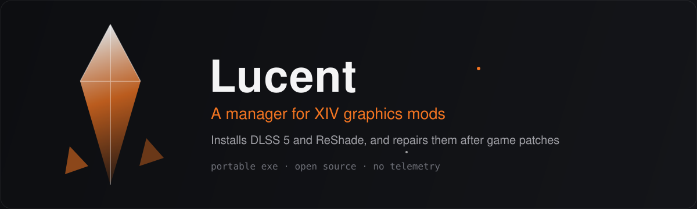

<p align="center">
  
</p>

<p align="center">
  <a href="https://github.com/arnaudcouturier/lucent/releases/latest"></a>
  <a href="LICENSE"></a>
  <a href="https://arnaudcouturier.github.io/lucent/"></a>
</p>

<p align="center">
  <a href="https://arnaudcouturier.github.io/lucent/"><b>Website</b></a>
  &nbsp;·&nbsp;
  <a href="https://arnaudcouturier.github.io/lucent/guide.html"><b>Guide</b></a>
  &nbsp;·&nbsp;
  <a href="https://arnaudcouturier.github.io/lucent/files.html"><b>Files</b></a>
  &nbsp;·&nbsp;
  <a href="https://github.com/arnaudcouturier/lucent/releases"><b>Releases</b></a>
</p>

<br>

Lucent is a portable Windows app that installs a tested DLSS 5 Neural Rendering and ReShade setup into your XIV game folder, and repairs it after game patches. Every file it replaces is backed up, and Uninstall puts them back.

## Download

**[Lucent.exe](https://github.com/arnaudcouturier/lucent/releases/latest/download/Lucent.exe)** &nbsp;·&nbsp; Windows 10 22H2 or 11 &nbsp;·&nbsp; x64

> [!NOTE]
> The first release isn't out yet. Until it is, [run from source](#development).

Lucent.exe isn't code-signed, so Windows warns on first launch. The site shows [what to expect](https://arnaudcouturier.github.io/lucent/#smartscreen) and how to verify the file.

## Features

| | |
|:--|:--|
| **Finds your game** | Game folder, launcher and graphics card. Works with XIVLauncher, Steam and the Square Enix launcher. |
| **Backs up first** | Scan lists every file it will replace, such as an existing GShade, ReShade or OptiScaler. Each one is backed up. |
| **Repairs after patches** | Every deployed file is checked against its hash. If a patch replaced one, Repair puts it back. |
| **Three profiles** | Fidelity, Balanced or Performance. Switch any time. |
| **Updates when you want** | New versions are offered, not forced. Versions rolls back. |
| **Clean uninstall** | Restores what it replaced and removes what it added. Your own presets and shaders stay. |
| **No telemetry** | Open source. [Every file it installs](https://arnaudcouturier.github.io/lucent/files.html) is listed with its SHA-256. |

## Supported cards

| Card | Setup | Content |
|:--|:--|:--|
| RTX 50 | DLSS 5 Neural Rendering + ReShade | Not yet |
| RTX 30 / 40 | DLSS 5 through the compatibility runtime + ReShade | **Beta** |
| RTX 20 | DLSS 5 through the compatibility runtime + ReShade | Not yet |
| Radeon | FSR upscaling and frame generation + ReShade | Not yet |
| Any other | ReShade and presets | Not yet |

To use Beta content, turn on **Beta channel** on the Scan screen. The [site](https://arnaudcouturier.github.io/lucent/#cards) reads this list from the manifest, so it is always current.

## Credits

Lucent installs other people's work. Each component ships with its licence.

| | |
|:--|:--|
| OptiScaler forks | [SirenBrink](https://github.com/SirenBrink/OptiScaler_DLSSNR_Multipass_MFG_FFXIV), [y4my4my4m](https://github.com/y4my4my4m/OptiScaler_DLSSNR_Multipass_MFG), [Dagherbou](https://github.com/Dagherbou/OptiScaler_DLSSNR) |
| Compatibility runtime | ShortFuse / [RenoDX](https://github.com/clshortfuse/renodx) |
| ReShade | [crosire](https://reshade.me/) |
| iMMERSE and qUINT | [Marty McFly](https://github.com/martymcmodding/iMMERSE) |
| SweetFX | [CeeJay.dk and contributors](https://github.com/CeeJayDK/SweetFX) |
| Alive presets | [Wafflezs](https://www.nexusmods.com/finalfantasy14/mods/156) |
| ipsuShade | [ipsusu](https://github.com/ipsusu/ipsuShade) |

## Development

```sh
npm ci
npm run dev          # UI in a browser, on a fake machine
npm run tauri dev    # the real app
npm test             # TypeScript tests
npm run test:rust    # Rust tests
npm run typecheck
```

`src/core/` is framework-free and reaches the machine only through the Platform port. `src-tauri/` is the Tauri 2 shell that implements it.

| | |
|:--|:--|
| [CONTEXT.md](CONTEXT.md) | Glossary |
| [docs/decisions.md](docs/decisions.md) | Design decisions |
| [docs/publishing.md](docs/publishing.md) | Publishing a content version |
| [docs/release-checklist.md](docs/release-checklist.md) | Cutting an app release |

## Licence

[MIT](LICENSE). The components Lucent installs keep their own licences.

Not affiliated with Square Enix. FINAL FANTASY XIV is a trademark of Square Enix Holdings Co., Ltd.
